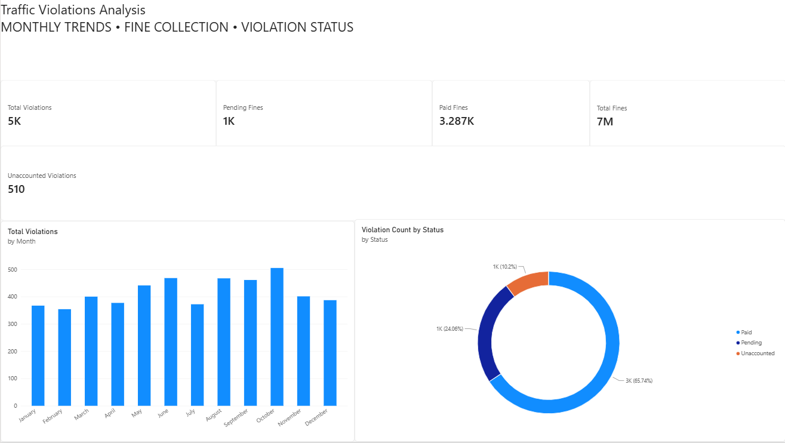

# Traffic Violations Analysis

A Power BI data analytics project exploring traffic violation patterns, fine collection, and payment status across different months, violation categories, vehicle types, and locations.

## Project Overview

This project analyzes a dataset containing 5,000 traffic violation records using Microsoft Power BI.

The objective is to transform raw violation records into an interactive analytical dashboard that helps understand:

- Monthly traffic violation trends.
- Total fines generated.
- Paid and pending violation counts.
- Overdue violations.
- Distribution of violations by payment status.

The project focuses on data exploration, DAX calculations, data modelling, and dashboard development.

## Dashboard Preview



*Traffic Violations Analysis — Power BI Dashboard*

## Key Metrics

| KPI | Result |
|---|---:|
| Total Violations | 5,000 |
| Total Fines | ₹67,68,400 |
| Paid Violations | 3,287 |
| Pending Violations | 1,203 |
| Overdue Violations | 510 |

*Note: The dashboard currently displays Paid Fines and Pending Fines as card labels, but these two metrics represent violation counts, not monetary amounts.*

## Dataset Information

- **Dataset:** `traffic_violations_5000.csv`
- **Records:** 5,000
- **Columns:** 10
- **Fine currency:** Indian Rupees (INR)
- **Time dimension:** Month (January–December)

### Data Dictionary

| Column | Description |
|---|---|
| Violation_ID | Unique identifier for each violation |
| Month | Month in which the violation occurred |
| Month_Number | Numeric representation of the month |
| Violation_Type | Category of traffic violation |
| Vehicle_Type | Type of vehicle involved |
| Location | Location associated with the violation |
| Fine_Amount_INR | Fine amount in Indian Rupees |
| Payment_Status | Paid, Pending, or Overdue |
| Enforcement_Method | Method used to detect the violation |
| Time_Of_Day | Time period when the violation occurred |

## Tools and Technologies

- **Microsoft Power BI:** Dashboard development and visualization.
- **DAX:** Measures and analytical calculations.
- **CSV:** Dataset storage and input.

## Data Preparation and Validation

The dataset was examined before dashboard development.

Validation checks included:

- Record count verification.
- Missing-value checks.
- Duplicate-record checks.
- Unique violation ID verification.
- Payment-status distribution checks.
- Fine amount aggregation.

### Validation Results

| Check | Result |
|---|---:|
| Total records | 5,000 |
| Unique violation IDs | 5,000 |
| Missing values | 0 |
| Exact duplicate rows | 0 |

The `Month_Number` column provides a chronological sorting reference for the monthly visualization.

## Dashboard Components

### 1. KPI Cards

The dashboard contains four primary KPI cards:

- Total Violations
- Total Fines
- Paid Fines (count)
- Pending Fines (count)

An additional card displays the calculated Unaccounted Violations value.

### 2. Monthly Violation Analysis

A clustered column chart displays the number of violations recorded in each month.

**Observations:**
- October recorded the highest number of violations (505).
- February recorded the lowest number (354).
- Monthly counts provide a comparative view of violation distribution.

### 3. Violation Status Distribution

A donut chart displays the distribution of violations by payment status.

| Payment Status | Count | Percentage |
|---|---:|---:|
| Paid | 3,287 | 65.74% |
| Pending | 1,203 | 24.06% |
| Overdue | 510 | 10.20% |
| **Total** | **5,000** | **100%** |

### 4. Unaccounted Violations

The dashboard calculates this metric by subtracting paid and pending violation counts from total violations.

The resulting 510 records correspond to the Overdue category in the source dataset.

## DAX Measures

The following reference expressions represent the calculation logic used in the report. They should be checked against the exact expressions in the PBIX before being treated as verbatim model definitions.

### Total Violations

```dax
Total Violations =
COUNTROWS(FactViolations)
```

### Total Fines

```dax
Total Fines =
SUM(FactViolations[Fine_Amount_INR])
```

### Paid Fines (Violation Count)

```dax
Paid Fines =
CALCULATE(
    COUNTROWS(FactViolations),
    FactViolations[Payment_Status] = "Paid"
)
```

### Pending Fines (Violation Count)

```dax
Pending Fines =
CALCULATE(
    COUNTROWS(FactViolations),
    FactViolations[Payment_Status] = "Pending"
)
```

### Unaccounted Violations

```dax
Unaccounted Violations =
[Total Violations]
    - [Paid Fines]
    - [Pending Fines]
```

The final measure produces 510, corresponding to overdue records in the dataset.

## Key Analytical Findings

1. A total of 5,000 traffic violation records were analyzed.
2. Paid violations account for approximately 65.74% of the dataset.
3. Pending violations account for approximately 24.06%.
4. Overdue violations account for approximately 10.20%.
5. October has the highest recorded monthly violation count.
6. Speeding is the most frequently recorded violation type, with 1,225 records.

These observations describe the supplied dataset and should not be interpreted as official citywide traffic statistics.

## Project Structure

```text
traffic-violations-analysis/
│
├── data/
│   ├── traffic_violations_5000.csv
│   └── data_dictionary.md
│
├── power-bi/
│   ├── traffic-violations.pbix
│   └── dax-measures.md
│
├── screenshots/
│   └── dashboard-overview.png
│
├── documentation/
│   ├── analysis.md
│   └── insights.md
│
├── README.md
└── .gitignore
```

## How to Explore the Project

1. Clone or download this repository.
2. Navigate to the `power-bi` folder.
3. Open `traffic-violations.pbix` using Microsoft Power BI Desktop.
4. If prompted, configure the CSV data source path.
5. Explore the dashboard and its available visual interactions.

## Limitations

- The dataset contains month names and month numbers, but no year or exact violation dates.
- Monthly comparisons therefore represent the supplied month-level distribution, not verified year-over-year trends.
- The dataset's original provenance has not yet been documented.
- The calculated Unaccounted Violations metric is a residual count that corresponds to the Overdue category in the supplied data.
- Findings are limited to the records available in the dataset.

## Project Status

**Version 1.0 — Dashboard Complete**

The initial dashboard includes KPI cards, monthly violation analysis, payment-status distribution, and DAX-based calculations.

Future improvements may include additional analysis by violation type, vehicle type, location, enforcement method, and time of day.

---

**Author:** [Your Name]

**GitHub:** [Your GitHub Profile]

**Tools:** Power BI | DAX | Data Analytics
